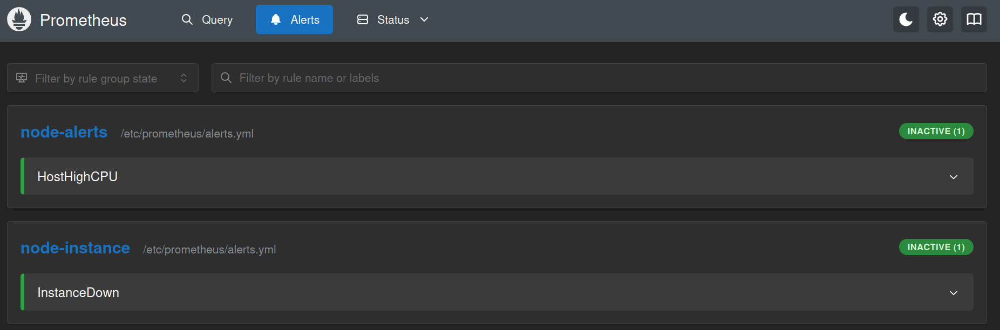
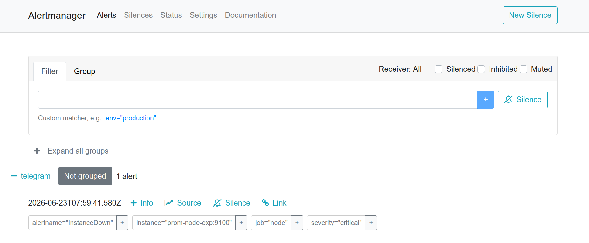
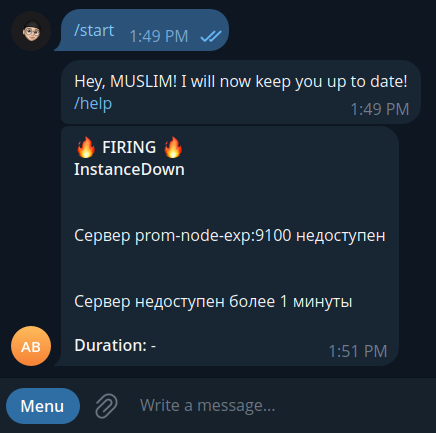

#  Алёртинг с Prometheus и Alertmanager

## 1. Опишем правила для алёртов

```
groups:
  - name: node-alerts
    rules:
      - alert: HostHighCPU
        expr: 100 - (
          avg(
          rate(
          node_cpu_seconds_total{mode="idle"}[5m]
          )
          ) * 100
          ) > 80
        for: 2m
        labels:
          severity: warning
        annotations:
          summary: "Высокая загрузка CPU"
          description: "CPU выше 80% более 2 минут"

  - name: node-instance
    rules:
      - alert: InstanceDown
        expr: up == 0
        for: 1m
        labels:
          severity: critical
        annotations:
          summary: "Сервер {{ $labels.instance }} недоступен"
          description: "Сервер недоступен более 1 минуты"
```

## 2. Укажем Telegram в конфиге Alertmanager для отображения уведомлений

```
route:
  receiver: telegram

receivers:
  - name: telegram
    webhook_configs:
      - url: http://prom-telegrambot:8080
```

## 3. Подключим в конфиге Prometheus правила алёртов, Alertmanager и сам Node Exporter

```
global:
  scrape_interval: 15s

scrape_configs:
  - job_name: "node"
    static_configs:
      - targets: ["prom-node-exp:9100"]

rule_files:
  - alerts.yml

alerting:
  alertmanagers:
    - static_configs:
        - targets:
            - prom-alertmanager:9093
```

## 4. Поднимем наш стек мониторинга

```
docker compose up -d
```

## 5. Убедимся, что Prometheus получает правила алёртов



## 6. Спровоцируем ситуацию, когда сервер лёг и убедимся, что Alertmanager это обрабатывает



## 7. Убедимся, что Telegram отправляет уведомления


